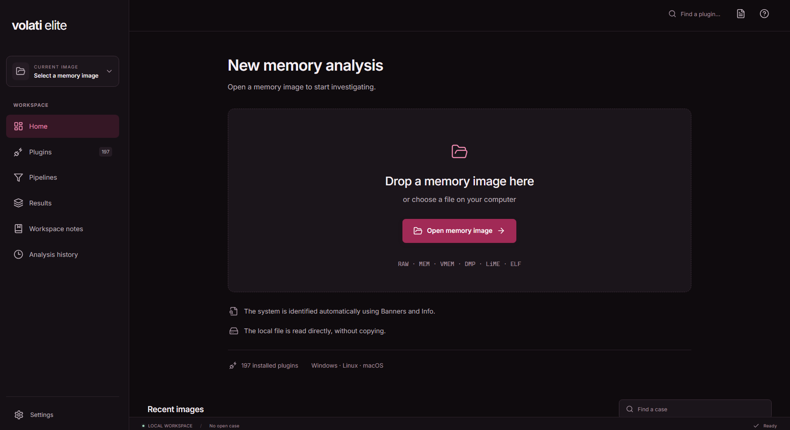
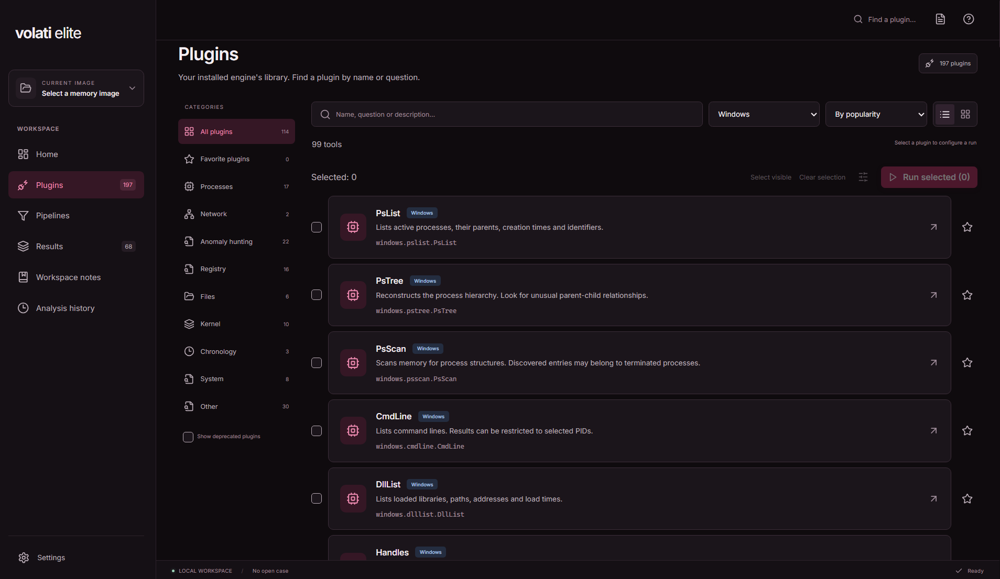

# Volati Elite

Volati Elite is a Windows desktop interface for [Volatility 3](https://github.com/volatilityfoundation/volatility3). It brings plugin execution, result analysis and investigation notes into a single and simple workspace.

## Download

[Windows x64 portable test build](https://github.com/serrr666/volati-elite/releases/tag/v0.4.14-test.1)

Download `VolatiElite.exe` from the release assets and run it.

## Quick start

1. Drop a memory image into the window, or choose it through the file dialog.
2. Wait for SHA-256 verification and review the detected OS. Analysis starts offline by default. If a plugin requires OS data, open **Settings → Analysis** to add matching local data or allow retrieval when appropriate.
3. Start with processes, network connections or command lines. Select several plugins to queue them together.
4. Filter the results, bookmark useful rows and write down your findings in the investigation notebook.
5. Use **Export → Copy CSV** to copy the results, or download them as CSV or JSON. Notes can be saved as TXT.

The original image is read from its existing location. Case data, results, caches and notes are stored locally. The profile folder remains `%LOCALAPPDATA%\Vol3Studio` for compatibility with earlier test builds.

## What is included

- A searchable plugin library with categories, practical descriptions and batch selection.
- Structured result tables with adjustable columns, full-result search and filters by unique values.
- Case notes, workspace notes and bookmarks linked to their source rows.
- Pipelines for processing plugin output and searching strings in an image.
- A run history, extracted-file access and case export.
- English, Russian, Simplified Chinese, Spanish, German and French interfaces.
- Light and dark themes.

Windows is the desktop target. Analysis support for Windows, Linux and macOS images depends on the bundled Volatility plugins, image format and available kernel data.

## Screenshots

### Home

### Plugins

## Testing and feedback

Volati Elite is currently a test build for analyst feedback. Cross-check important findings with the underlying engine. An empty result does not establish that an artifact is absent.

Bug reports are welcome in [Issues](https://github.com/serrr666/volati-elite/issues), or in Telegram direct @serpf

## License and author

[Volatility Software License 1.0](LICENSE). Third-party notices and bundled font licenses are included in the repository. Volatility 3 is developed by the Volatility Foundation.

Project: [serrr666](https://github.com/serrr666).
