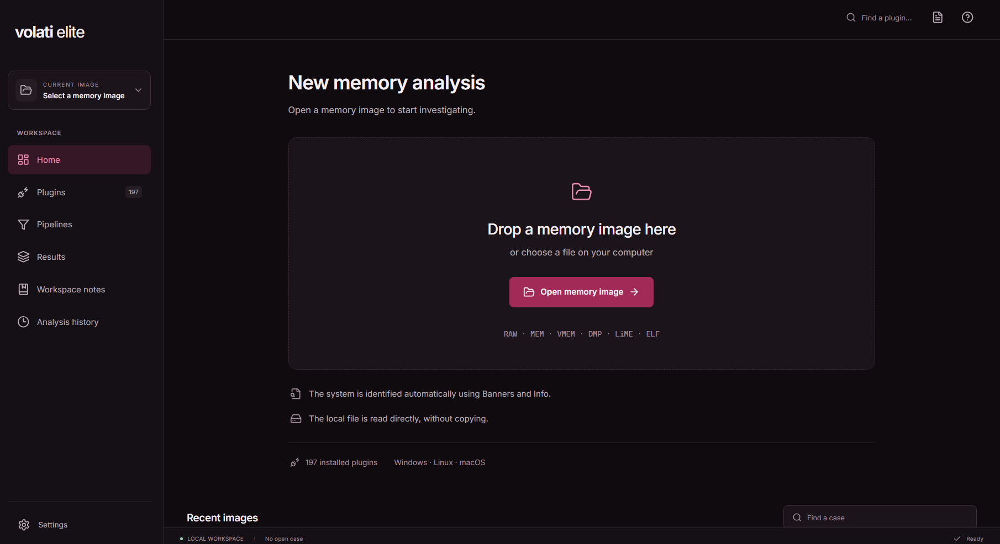
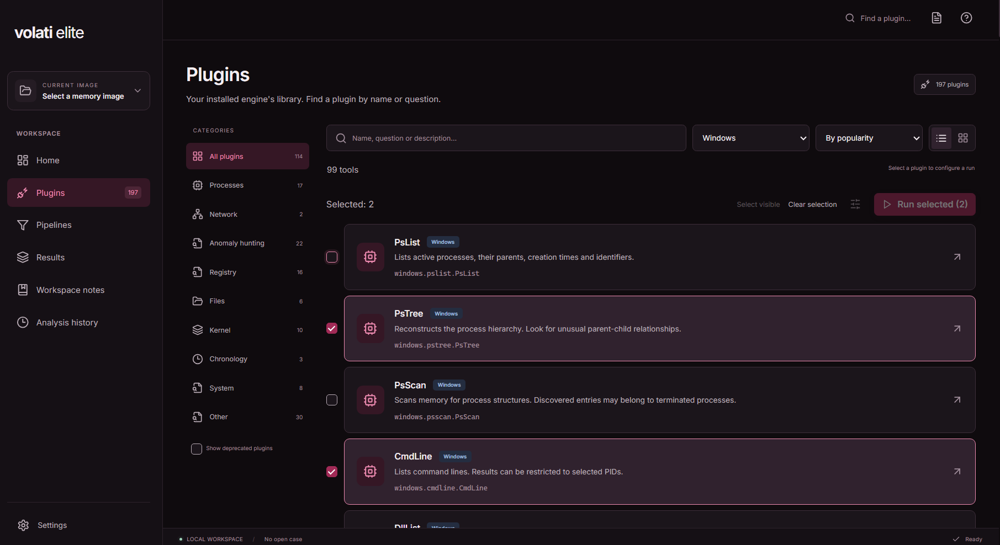

# volati elite

Volati Elite is a desktop interface for [Volatility 3](https://github.com/volatilityfoundation/volatility3). I built it to make memory analysis easier to navigate: choose an image, run the plugins you need, filter their output and keep your investigation notes in the same window.

**Early test version.** Stability, performance and everyday usability are still being improved. This is an independent project, not an official Volatility Foundation product.

## Download

[Windows x64 portable test build](https://github.com/serrr666/volati-elite/releases/tag/v0.4.9-test.1)

Download `VolatiElite.exe` from the pre-release assets and run it. Python, Node.js and a separate browser are not required. Checksums are provided with the download. The executable is currently unsigned.

## Quick start

1. Drop a memory image into the window, or choose it through the file dialog.
2. Let the app finish the source checks and review the detected system. Linux and macOS analysis may require matching kernel data.
3. Start with processes, network connections or command lines. Select several plugins to queue them together.
4. Filter the results, bookmark useful rows and write down your findings in the investigation notebook.
5. Export the relevant results as CSV or JSON, or save your notes as TXT.

The original image is read from its existing location. Case data, results, caches and notes are stored locally. The profile folder remains `%LOCALAPPDATA%\Vol3Studio` for compatibility with earlier test builds.

## What is included

- A searchable plugin library with categories, practical descriptions and batch selection.
- Structured result tables with adjustable columns, full-result search and filters by unique values.
- Case notes, workspace notes and bookmarks linked to their source rows.
- Pipelines for processing plugin output and searching strings in an image.
- A run history, extracted-file access and case export.
- English, Russian, Simplified Chinese, Spanish, German and French interfaces.
- Light and dark themes.

Windows is the desktop target. Analysis support for Windows, Linux and macOS images depends on the bundled Volatility plugins, image format and available kernel data.

## Screenshots

### Home



### Plugins



## Build from source

The current test build uses Python 3.12, TypeScript/React, PySide6/Qt and PyInstaller. Run these commands on Windows with Python 3.12 and Node.js available:

```powershell
git clone https://github.com/serrr666/volati-elite.git
cd volati-elite
py -3.12 -m venv .venv
.\.venv\Scripts\python.exe -m pip install -r requirements-build.lock.txt
cd frontend
npm ci
npm run build
cd ..
.\.venv\Scripts\python.exe desktop_entry.py
```

To build the portable executable:

```powershell
.\.venv\Scripts\python.exe -m PyInstaller --noconfirm VolatiElite.spec
```

The executable will be written to `dist/VolatiElite.exe`.

## Testing and feedback

This is a test project, not a validated forensic suite. Image compatibility, plugins and resource usage need further testing. Cross-check important findings with the underlying engine; an empty result does not prove an artifact is absent.

Bug reports are welcome in [Issues](https://github.com/serrr666/volati-elite/issues). Include the app version, plugin, image format and steps to reproduce. Please do not attach private memory images, credentials or unreviewed case data. See [CONTRIBUTING.md](CONTRIBUTING.md) and [SECURITY.md](SECURITY.md).

## License and author

[Volatility Software License 1.0](LICENSE). Third-party notices and bundled font licenses are included in the repository. Volatility 3 is developed by the Volatility Foundation.

Project: [serrr666](https://github.com/serrr666).
